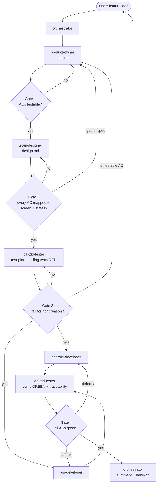

# AI Mobile Team – Workflow

Agents live in `.github/agents/` and all use model `claude-opus-5.5`. Each acts like a company role with defined inputs, outputs and gates.

## Roles
| Agent | Role | Owns |
|---|---|---|
| `orchestrator` | Engineering Manager | flow, gates, escalation |
| `product-owner` | PO | `spec.md` |
| `ux-ui-designer` | UX/UI | `design.md` |
| `qa-tdd-tester` | QA / TDD | `test-plan.md`, tests (RED), verification |
| `android-developer` | Android dev | Kotlin/Compose code |
| `ios-developer` | iOS dev | Swift/SwiftUI code |

## Flow


## Artifacts per feature
```
docs/features/<name>/
  spec.md        # product-owner
  design.md      # ux-ui-designer
  test-plan.md   # qa-tdd-tester (AC → test traceability)
```

## Usage
```
copilot --agent orchestrator
> Build feature: biometric login for the mobile app
```
Or call a single role directly, e.g. `copilot --agent qa-tdd-tester`.

## Change rules
- Spec changes restart the flow from the affected stage and notify downstream roles.
- Max 3 rework loops per gate, then escalate to the user.
